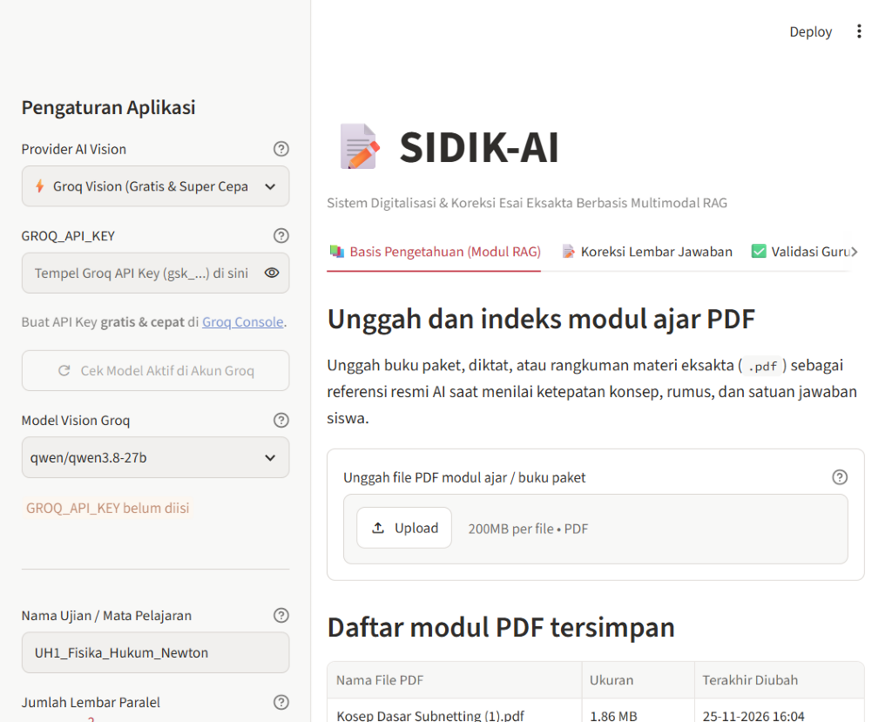
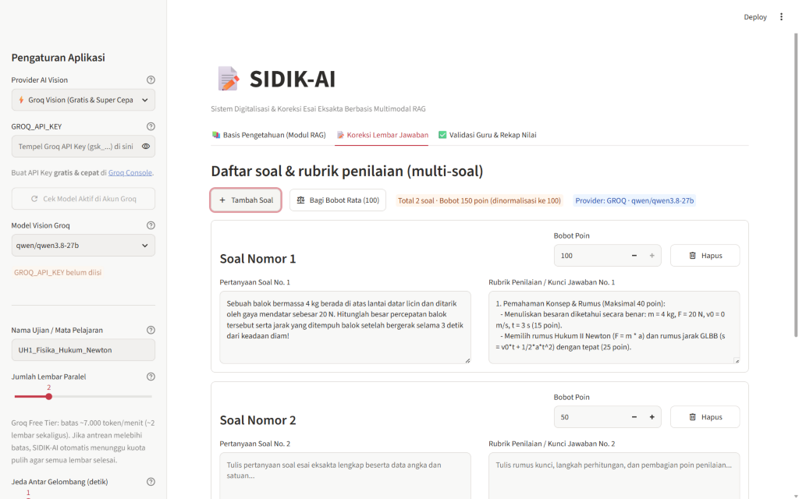
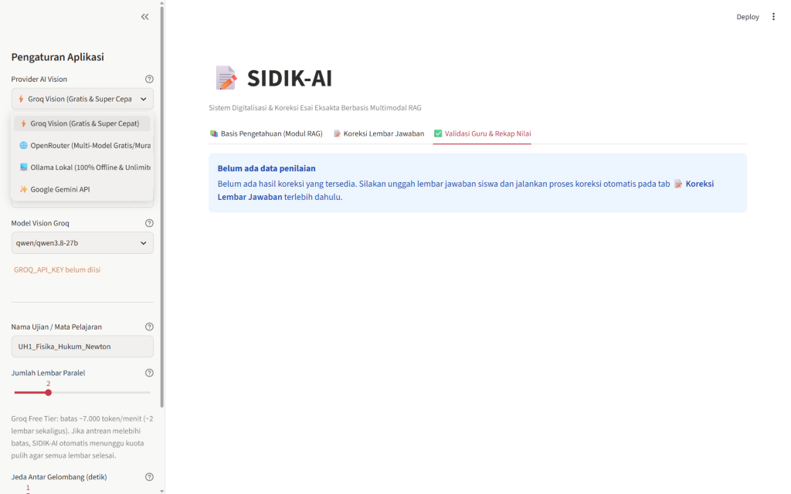
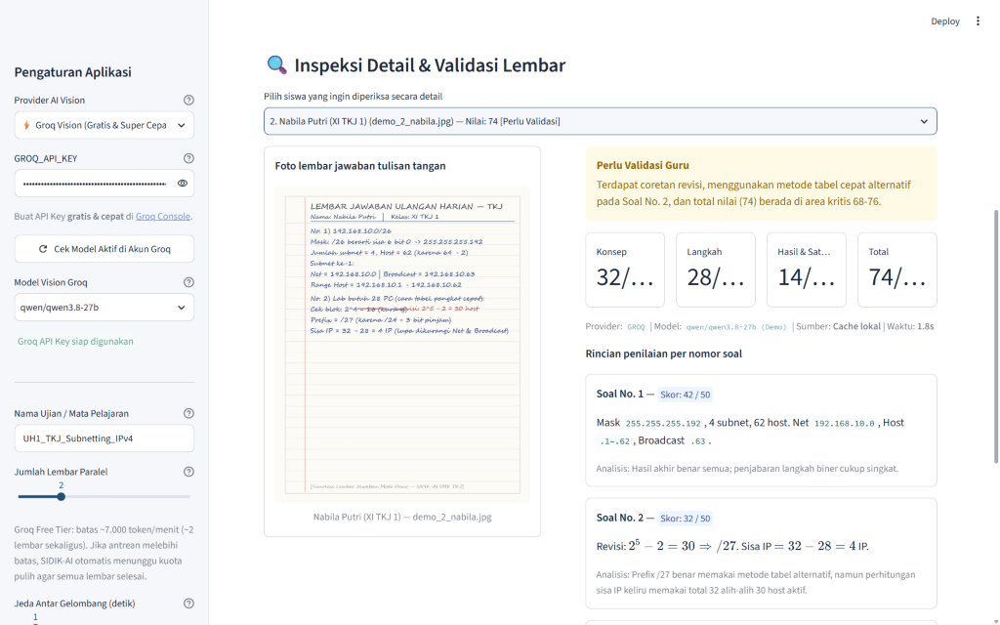
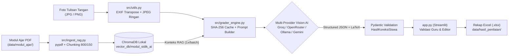

# 📝 SIDIK-AI — Sistem Digitalisasi & Koreksi Esai Eksakta Berbasis AI


[](https://sidik-ai.streamlit.app)

**SIDIK-AI** (*Sistem Digitalisasi & Koreksi Esai Berbasis AI*) adalah aplikasi web lokal (*Local Web App*) berbasis Python & Streamlit yang dirancang khusus untuk membantu guru mengoreksi **lembar jawaban tulisan tangan mata pelajaran eksakta** (Matematika, Fisika, Kimia, dan Teknologi/Informatika) secara cepat, adil, dan terstruktur menggunakan arsitektur **Multimodal RAG (Retrieval-Augmented Generation)**.

Berbeda dari alat koreksi jawaban singkat biasa, SIDIK-AI **menghargai proses dan langkah pengerjaan siswa** (pemahaman konsep, pemilihan rumus, substitusi angka, hingga penulisan satuan SI), menyalin tulisan tangan ke format **Markdown & LaTeX**, merujuk langsung ke **modul ajar PDF guru** melalui basis data vektor lokal (ChromaDB), serta menandai lembar yang memerlukan peninjauan manual guru (*human-in-the-loop*).

---

## ✨ Fitur Utama

- **📚 Basis Pengetahuan RAG Lokal & Offline (ChromaDB + `all-MiniLM-L6-v2`)**
  - Unggah banyak file PDF modul ajar/buku paket ke `./data/modul_ajar/`.
  - Ekstraksi teks per halaman, *chunking* cerdas (~800 karakter, *overlap* 150 karakter), dan ID deterministik berbasis SHA-256 (anti-duplikasi saat file diindeks ulang).
  - Embedding berjalan **100% lokal, gratis, dan offline** di laptop.
- **🌐 Multi-Provider Vision AI (Anti-Limit & Fleksibel)**
  - **⚡ Groq Vision (`qwen/qwen3.8-27b`)**: Gratis, super cepat (~1,6 detik/lembar), dilengkapi pemangkasan token prompt otomatis dan *Smart Auto-Wait* membaca `Retry-After`.
  - **🌐 OpenRouter**: Mendukung `openrouter/free`, `google/gemma-4-31b-it:free`, `nvidia/nemotron-3.5-super-vl:free`, maupun model kustom lain.
  - **💻 Ollama Lokal**: 100% offline, gratis, tanpa API Key, tanpa limit selamanya (mis. `qwen2.5vl:7b`, `gemma3:4b`, `llama3.2-vision`) + tombol deteksi otomatis model terpasang.
  - **✨ Google Gemini API**: Mendukung `gemini-3.8-flash` (Mode Cepat `minimal` / Teliti `low`), *auto-fallback* `gemini-3.5-flash-lite` untuk `429`/`503`, serta audit mendalam `gemini-4-neon` (*Paid Tier*).
- **📝 Multi-Soal Dinamis + Tata Letak 2 Kolom**
  - Tambah/hapus butir soal secara dinamis (Soal No. 1, 2, 3, ...) dengan kolom **Pertanyaan Soal** dan **Rubrik/Kunci Jawaban** berdampingan serta tombol **Bagi Bobot Rata (100)**.
  - 1 foto lembar jawaban berisi banyak nomor soal tetap dinilai dalam **1 panggilan API** lengkap dengan rincian skor per nomor soal.
- **⚡ Cepat, Hemat Token, & Anti-Gagal**
  - **Auto-EXIF & Kompresi JPEG Ringan**: Otomatis meluruskan rotasi foto kamera HP (`ImageOps.exif_transpose`) dan mengirim payload JPEG tajam (~120–250 KB, bukan PNG multi-MB).
  - **RAG 1× per Batch & Eksekusi Paralel**: Pencarian ChromaDB cukup dijalankan sekali di awal batch, lalu lembar diproses paralel per gelombang (`ThreadPoolExecutor`).
  - **Intelligent Caching (`./data/cache/`)**: Hash SHA-256 dari gambar + soal + rubrik + provider + model agar pemrosesan ulang instan (0 token).
- **✅ Validasi Guru, Audit Ulang, & Ekspor Excel (`.xlsx`)**
  - Penandaan otomatis `perlu_validasi_guru` bila tulisan buram, banyak coretan, memakai cara alternatif valid, atau nilai berada di area kritis **68–76**.
  - Tabel interaktif (`st.data_editor`) untuk edit nilai/umpan balik manual, tampilan 2 kolom (foto tulisan tangan asli vs transkripsi LaTeX & analisis langkah), tombol **Audit Ulang**, serta ekspor otomatis ke **Excel terformat rapi** di `./data/hasil_penilaian/`.

---

## 🖼️ Tangkapan Layar Aplikasi

### 1. Basis Pengetahuan (Modul RAG PDF) & Sidebar Pengaturan
Unggah buku paket atau modul ajar PDF, lihat daftar file tersimpan, lalu indeks ke memori lokal ChromaDB dalam satu klik.



### 2. Koreksi Lembar Jawaban (Multi-Soal Dinamis 2 Kolom)
Tambah beberapa nomor soal secara dinamis dengan tata letak 2 kolom berdampingan (Pertanyaan Soal di kiri, Rubrik & Kunci Jawaban di kanan), pengaturan bobot poin, dan unggah banyak foto lembar jawaban sekaligus.



### 3. Pilihan 4 Provider AI Vision & Tab Validasi Guru
Ganti provider AI kapan saja langsung dari sidebar (Groq, OpenRouter, Ollama Lokal, atau Google Gemini) dan tinjau rekap nilai, inspeksi LaTeX, serta ekspor Excel pada Tab Validasi Guru.



### 4. Inspeksi Detail & Mode Demo 1-Klik SMK TKJ (Tanpa API Key)
Klik tombol **🎯 Muat Mode Demo TKJ** di sidebar atau Tab 3 untuk langsung mencoba inspeksi foto tulisan tangan *Subnetting IPv4* berdampingan dengan peringatan **Perlu Validasi Guru**, rincian skor per nomor soal, transkripsi LaTeX, dan ekspor Excel tanpa perlu memasukkan API Key.



---

## 🏗️ Arsitektur Sistem



---

## 📁 Struktur Direktori Proyek

```text
sidik-ai/
├── app.py                        # Antarmuka web lokal Streamlit (Sidebar + 3 Tab)
├── requirements.txt              # Daftar dependensi Python
├── .env.example                  # Template variabel lingkungan (API Key & Ollama URL)
├── .gitignore                    # Mengabaikan venv/, .env, vector_db/*, dan isi data/
├── docs/
│   └── screenshots/              # Tangkapan layar dokumentasi aplikasi
├── data/
│   ├── modul_ajar/               # Folder tempat menyimpan modul ajar PDF (RAG)
│   ├── lembar_jawaban/           # Folder opsional arsip foto lembar jawaban siswa
│   ├── hasil_penilaian/          # Output file rekap Excel (.xlsx) berstempel waktu
│   └── cache/                    # Cache JSON SHA-256 otomatis (diabaikan oleh Git)
├── vector_db/                    # Penyimpanan persisten ChromaDB lokal
└── src/
    ├── __init__.py
    ├── ingest_rag.py             # Ekstraksi PDF, chunking, indeksasi & pencarian ChromaDB
    ├── grader_engine.py          # Skema Pydantic, cache SHA-256, & klien Multi-Provider AI
    └── utils.py                  # Kompresi gambar EXIF-aware, JPEG bytes, & ekspor Excel
```

---

## 🤖 Perbandingan Provider AI Vision yang Didukung

| Provider | Model Default | Kecepatan | Kuota & Biaya | Rekomendasi Penggunaan |
| --- | --- | --- | --- | --- |
| **⚡ Groq Vision** | `qwen/qwen3.8-27b` | Sangat cepat (~1,6 dtk/lembar) | **Gratis** (Free Tier ~7.000 token/menit + *auto-wait*) | Pilihan utama gratis & cepat |
| **🌐 OpenRouter** | `openrouter/free` / `google/gemma-4-31b-it:free` | Cepat (~3–6 dtk/lembar) | Model `:free` & model berbayar sangat murah | Fleksibel, 1 API Key untuk banyak model |
| **💻 Ollama Lokal** | `qwen2.5vl:7b` / `gemma3:4b` | Cepat dengan GPU NVIDIA ≥ 6 GB | **100% Gratis, Offline, Tanpa Limit** | Privasi data siswa penuh & tanpa internet |
| **✨ Google Gemini** | `gemini-3.8-flash` (+ audit `gemini-4-neon`) | Cepat (~2–5 dtk/lembar) | Free Tier (project baru) / Paid Tier | Audit mendalam pada soal sangat kompleks |

---

## 🚀 Panduan Instalasi & Menjalankan Aplikasi

### Prasyarat
- **Python 3.10+** (disarankan Python 3.11–3.13)
- Koneksi internet (hanya saat instalasi awal, pengunduhan cache model embedding lokal pertama kali, dan jika menggunakan provider cloud seperti Groq/OpenRouter/Gemini).

### 1. Clone Repositori
```bash
git clone https://github.com/hayodavis/sidik-ai.git
cd sidik-ai
```

### 2. Buat Virtual Environment & Instal Dependensi

**Windows (PowerShell):**
```powershell
python -m venv venv
.\venv\Scripts\Activate.ps1
python -m pip install --upgrade pip
pip install -r requirements.txt
```

**Linux / macOS:**
```bash
python3 -m venv venv
source venv/bin/activate
python -m pip install --upgrade pip
pip install -r requirements.txt
```

### 3. Konfigurasi `.env` (Opsional — Bisa Juga Diisi Langsung di Sidebar)
Salin `.env.example` menjadi `.env` lalu isi minimal **satu** provider yang ingin digunakan:

```env
# 1. Groq API (Gratis & Super Cepat) -> https://console.groq.com/keys
GROQ_API_KEY=gsk_xxxxxxxxxxxxxxxxxxxxxxxx

# 2. OpenRouter API -> https://openrouter.ai/keys
OPENROUTER_API_KEY=

# 3. Google Gemini API -> https://aistudio.google.com/apikey
GEMINI_API_KEY=

# 4. Ollama Lokal (tanpa API Key)
OLLAMA_BASE_URL=http://localhost:11434
```

> **Catatan Ollama Lokal:** Jika ingin 100% offline tanpa API Key, instal [Ollama](https://ollama.com/download) lalu unduh salah satu model vision:
> ```bash
> ollama pull qwen2.5vl:7b
> # atau model yang lebih ringan:
> ollama pull gemma3:4b
> ```

### 4. Jalankan Aplikasi Web Lokal
```bash
streamlit run app.py
```
Buka browser di **`http://localhost:8501`**.

---

## 📖 Alur Penggunaan untuk Guru

1. **Atur Provider di Sidebar**: Pilih provider AI (misalnya **⚡ Groq Vision**), masukkan API Key (otomatis terisi jika sudah di `.env`), dan tulis **Nama Ujian / Mata Pelajaran**.
2. **Tab 1 — 📚 Basis Pengetahuan (Modul RAG)**:
   - Unggah file PDF modul ajar/buku paket, lalu klik **Proses & Simpan ke Memori AI**.
   - Database vektor tersimpan permanen di `./vector_db/` sehingga cukup diproses sekali per bab/semester.
3. **Tab 2 — 📝 Koreksi Lembar Jawaban**:
   - Isi **Pertanyaan Soal** (kiri), **Rubrik / Kunci Jawaban** (kanan), dan **Bobot Poin**. Klik **+ Tambah Soal** jika ujian terdiri dari beberapa nomor soal.
   - Unggah foto/scan lembar jawaban siswa (`JPG`/`JPEG`/`PNG`), lalu klik **🚀 Mulai Koreksi Otomatis AI**.
4. **Tab 3 — ✅ Validasi Guru & Rekap Nilai**:
   - Pantau **Total Siswa Dikoreksi**, **Rata-rata Nilai Kelas**, dan jumlah lembar **Perlu Validasi Guru**.
   - Edit nilai/umpan balik langsung di tabel bila diperlukan lalu klik **💾 Simpan Perubahan Tabel**.
   - Periksa lembar bertanda kuning di bagian **🔍 Inspeksi Detail** (foto asli di kiri, transkripsi LaTeX & analisis per soal di kanan) dan gunakan tombol **Audit Ulang** bila perlu.
   - Klik **📥 Unduh Rekap Nilai Excel (`.xlsx`)** untuk mengunduh sekaligus mengarsipkan laporan di `./data/hasil_penilaian/`.

---

## 🛠️ Pemecahan Masalah Singkat

- **HTTP 402 pada Gemini (`Your prepayment credits are depleted`)**: Saldo kredit *prepay* AI Studio habis. Pindah ke **Groq Vision** / **OpenRouter** / **Ollama Lokal** di sidebar, atau buat API Key Gemini baru di project Free Tier tanpa billing *prepay*.
- **HTTP 429 pada Groq (`input tokens per minute`)**: Groq Free Tier membatasi ~7.000 input token/menit (~2 lembar per gelombang). Gunakan **Jumlah Lembar Paralel = 1 atau 2**; SIDIK-AI sudah dilengkapi *Smart Auto-Wait* yang otomatis menunggu sesuai `Retry-After` lalu melanjutkan koreksi hingga semua lembar selesai.
- **Ollama tidak terdeteksi**: Pastikan layanan Ollama berjalan (`ollama serve`) dan klik **Deteksi Model Terpasang di Ollama** di sidebar.

---

## 📄 Lisensi

Proyek ini dikembangkan untuk mendukung digitalisasi dan efisiensi penilaian pembelajaran eksakta di Indonesia. Silakan kembangkan dan sesuaikan dengan kebutuhan kelas atau institusi Anda.
